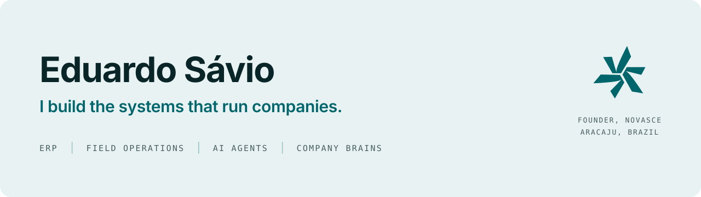

<picture>
  <source media="(prefers-color-scheme: dark)" srcset="./cabecalho-escuro.svg">
  
</picture>

I'm Eduardo, founder of [Novasce](https://www.novasce.com), a software company in Aracaju, Brazil. I design and ship the systems companies run on every day, and I build them with AI agents as part of the team.

> Em português: construo os sistemas que rodam empresas, com agentes de IA no time.

## What I build

**An ERP that runs a company.** Finance, sales, support desk, team and billing for our SaaS products, in one place. AI agents work inside it through an MCP connector, and a native macOS app sits on top. 215 releases between September and November 2026.

**Field operations for a solar energy company.** Projects, crews, budgets and finance for a company that installs solar plants, used every day by its team.

**AI agents and company brains.** Each company gets a knowledge base that its agents read before they act: rules, decisions, lessons and a queue of work. Every repository carries its own instructions, so any agent starts from what the team already learned.

**[Novasce OS](https://github.com/Novasce/novasce-os).** A Linux image for the team's machines, built on Aurora and bootc, signed, and updated once a week.

## How I work

- One founder, several agents, production every day: 3,598 pull requests merged in 2026, 2,181 of them in the last three months.
- No waiting on CI: each change proves itself locally, with types, tests and a measured result in the pull request.
- Every decision on one page, with a recommendation, marked by hand, then applied and verified.

## Stack

TypeScript, React, Next.js, NestJS, Prisma, PostgreSQL, Python, FastAPI, Swift, Railway and Vercel.

## Elsewhere

[novasce.com](https://www.novasce.com) and [LinkedIn](https://www.linkedin.com/in/savioeduardo).

Numbers measured on GitHub on November 17, 2026.
